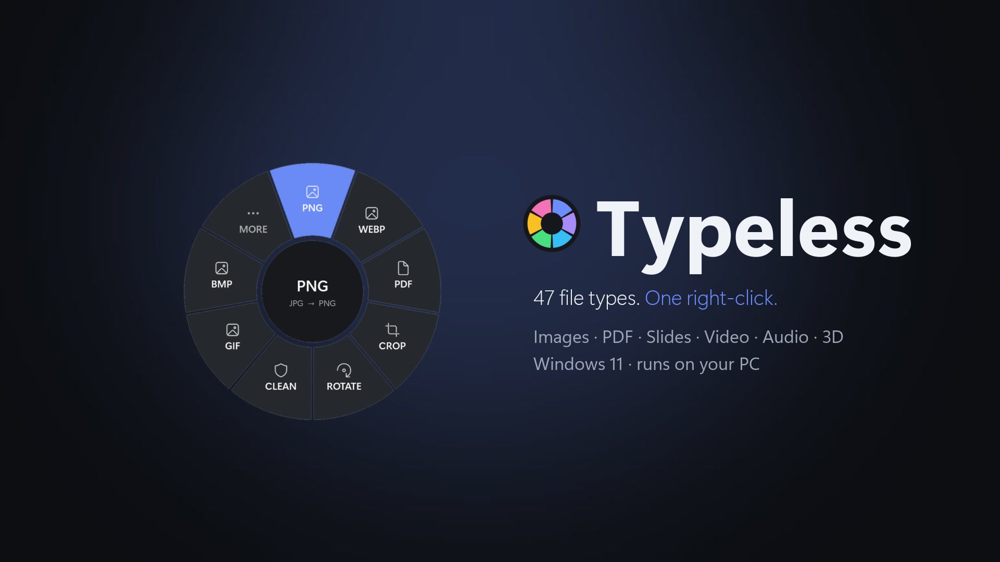
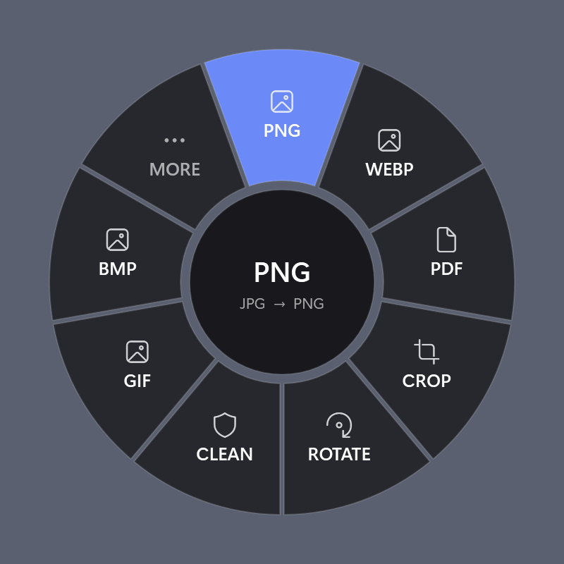
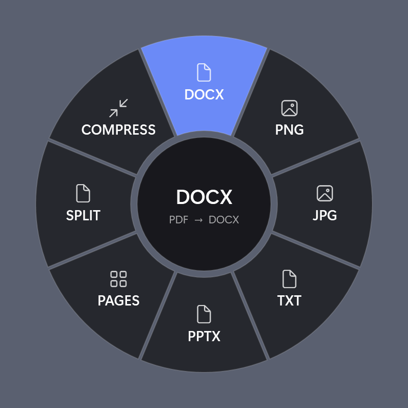
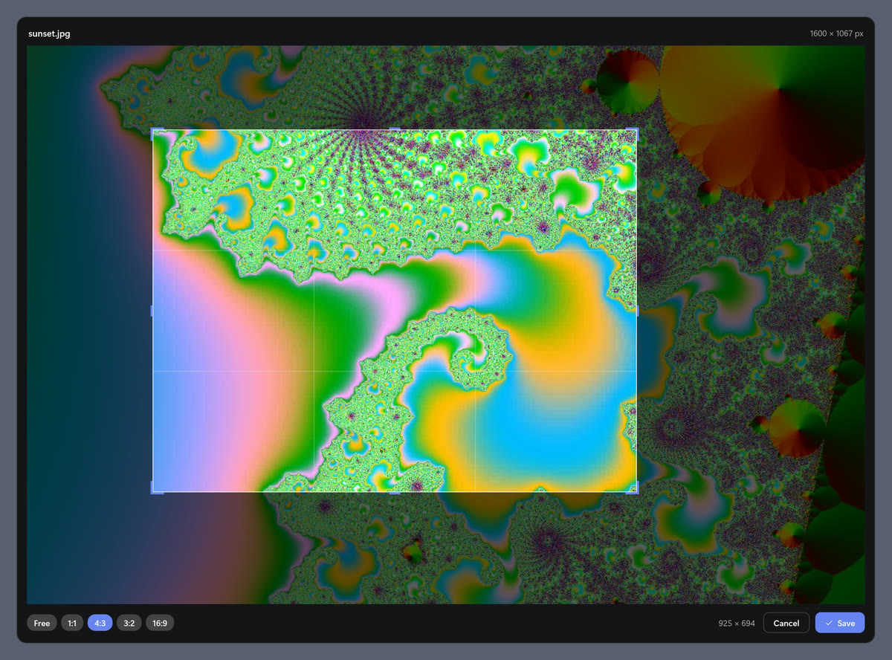
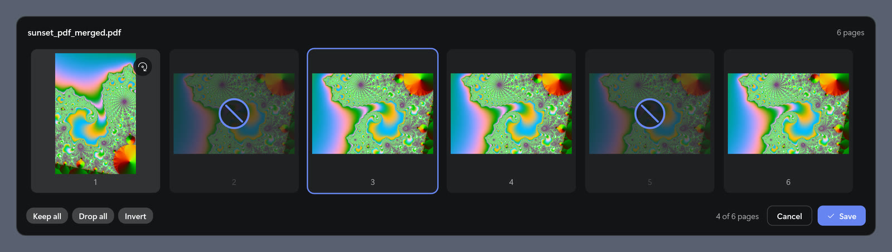
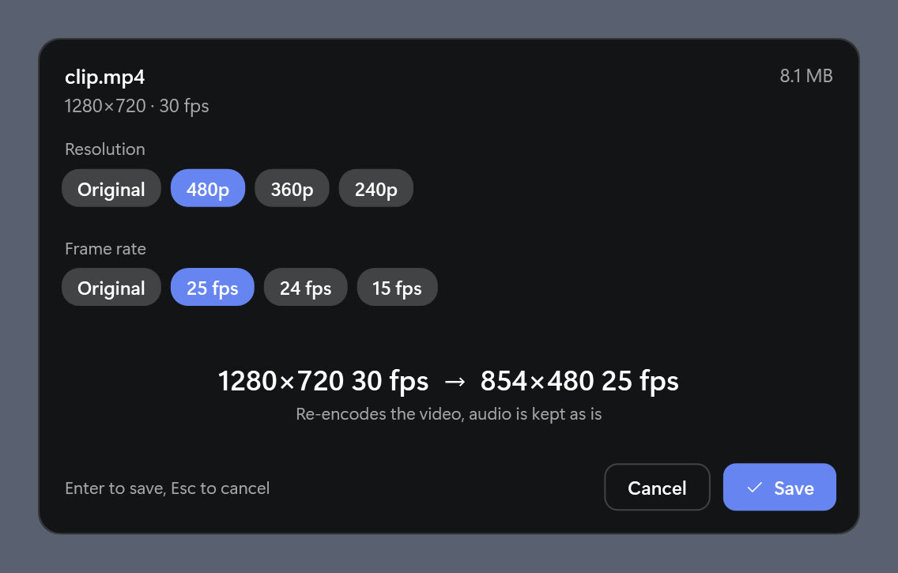

# Typeless



[](https://github.com/Fahadxx/typeless/releases)
[](LICENSE)

[](https://github.com/Fahadxx/typeless/actions/workflows/release.yml)

**Convert files straight from the right-click menu.** Right-click a file in Explorer, choose **Convert with Typeless**, and pick a format on the round menu that opens at your cursor. The new file is saved next to the original, for example `report.pdf` becomes `report_docx.docx`. Existing files are never overwritten.

| Right-click a photo | Right-click a PDF |
|:---:|:---:|
|  |  |

- **47 file types**: images, PDFs, documents, spreadsheets, slides, audio, video and 3D models.
- **Quick edits too**: crop, trim, rotate, resize, remove metadata, and merge, split, reorder or compress PDFs.
- **No quality loss where it can be avoided**: videos are copied as they are before anything is re-encoded, and 3D geometry stays exact.
- **Private**: everything runs on your PC. No account, no tracking, no uploads.
- **Free and open source** under the MIT license.

## Install

1. Download the installer from [Releases](https://github.com/Fahadxx/typeless/releases):
   - `TypelessSetup-<version>-x64.exe` for most PCs (Intel or AMD).
   - `TypelessSetup-<version>-arm64.exe` for ARM PCs (Snapdragon and similar).

   Not sure? Settings > System > About > **System type** tells you.
2. Run it. It installs for your user only, needs no admin rights, and includes everything it needs to run.
3. Right-click a file and choose **Convert with Typeless**.

**Windows 11:** current releases are not code-signed yet, so the entry is under **Show more options** (or Shift+right-click). Once signed releases start, it moves to the main menu.

**SmartScreen:** because the installer is new and unsigned, Windows may show "Windows protected your PC". Click **More info** > **Run anyway**. To be sure the file is genuine, compare it with `SHA256SUMS.txt` from the same release:

```powershell
Get-FileHash .\TypelessSetup-0.12.0-x64.exe
```

**Requirements:** Windows 10 version 2004 or later, or Windows 11, on x64 or ARM64.

### Optional programs

Typeless uses these when they are installed. Without them, the formats they handle are simply hidden from the menu.

| Program | Adds |
|---|---|
| [ffmpeg](https://ffmpeg.org) | Audio, video and webp. Setup can install it for you (tick "Also install ffmpeg"), or run `winget install Gyan.FFmpeg`. |
| Microsoft Word | PDF to docx/txt, and document conversions |
| Microsoft PowerPoint | Slide conversions |
| [LibreOffice](https://www.libreoffice.org) | Documents, spreadsheets and slides, when Word or PowerPoint is missing |

The last page of Setup lists which of these it found.

### Update and uninstall

- **Update:** run the installer of a newer version. It shows which version you have and asks before updating.
- **Uninstall:** Settings > Apps > Installed apps > **Typeless** > Uninstall. This removes the app, the menu entry and its temporary files, and asks whether to keep the log.

## What you can do

| Converts | To |
|---|---|
| Images: png, jpg, jfif, bmp, gif, tiff, webp, ico, heic, heif, avif | png, jpg, webp, bmp, gif, tiff, ico, pdf |
| PDF | docx, txt, png, jpg, pptx |
| Documents: docx, doc, odt, rtf, txt | pdf, docx, odt, rtf, txt, html, png, jpg |
| Spreadsheets: xlsx, xls, ods, csv | pdf, xlsx, ods, csv, html |
| Slides: pptx, ppt, odp | pdf, pptx, odp, png, jpg |
| Audio: mp3, wav, flac, m4a, aac, ogg, opus, wma | mp3, wav, flac, m4a, ogg, opus |
| Video: mp4, mov, mkv, avi, webm, wmv, flv, m4v | mp4, mkv, webm, mov, avi, gif, mp3, wav |
| 3D models: stl, 3mf, obj, ply, glb | any of the other four |

Besides converting, the menu offers quick edits that fit the file:

| Crop an image | Pick and reorder PDF pages | Resize a video |
|---|---|---|
|  |  |  |

### Images

- **Crop**: drag a box or pick a ratio (1:1, 4:3, 3:2, 16:9), then press Enter. Saved in the same format.
- **Rotate**: turn left or right, flip horizontally or vertically.
- **Clean**: removes location, camera, date and software details without touching the picture. Orientation and colors are kept.

### Video and audio

- **Trim**: a timeline with a filmstrip or waveform and playback. Cuts are exact by default; **Lossless** keeps the original quality and starts at the nearest keyframe.
- **Resize**: lower the resolution (down to 240p) and/or the frame rate, with progress and time left. Phone videos come out the right way up.
- **Audio**: saves a video's soundtrack exactly as it is, with no re-encoding.
- **Rotate** and **Clean** work on videos too. mp4 and mov rotate without any quality loss.

### PDF

- **Pages**: a thumbnail grid to keep, drop, reorder and rotate pages.
- **Split**: one PDF per page.
- **Merge**: select several PDFs and images to combine them into one PDF.
- **Compress**: shows the size you'd get with Light, Balanced and Strong before you choose. Only images are shrunk; text and fonts stay as they are.

### 3D models

- Converts between stl, 3mf, obj, ply and glb with no extra software. Geometry is exact, and sizes stay correct. Part names and colors are kept where the format supports them.
- **Parts**: finds the separate objects in a file (even an STL where everything is merged) and shows them from above. Click objects or drag a box to choose which to keep, then save them as one file or one file per object.
- Every output is read back and checked before it is saved.

### Naming and keyboard

- Output names: `photo_png.png` for conversions, `photo_crop.jpg` for edits, with ` (2)` added if the name is taken.
- With more than 9 options, the menu shows the 8 most used plus **More**. Keys 1-9 pick an option, Tab switches pages, Esc closes.

## Troubleshooting

- **I don't see Convert with Typeless.** On Windows 11, click **Show more options**. If it still isn't there, restart Explorer (Task Manager > Windows Explorer > Restart) or sign out and back in.
- **A format I expected is missing.** It probably needs one of the [optional programs](#optional-programs). Install it and the format appears.
- **A conversion failed.** The log at `%LOCALAPPDATA%\Typeless\typeless.log` says why. Please include the relevant lines if you [open an issue](https://github.com/Fahadxx/typeless/issues).

## Privacy

This program will not transfer any information to other networked systems unless specifically requested by the user or the person installing or operating it.

- Typeless makes no network connections: no tracking, no account and no update check. Files are converted on your PC, and temporary copies are deleted afterwards.
- The only network use is the optional ffmpeg download in Setup, which happens only if you tick it.
- Documents are opened in Word, PowerPoint or LibreOffice with macros turned off. Those programs may still load content a document links to, such as online images.
- The log stays on your PC and contains only file paths and errors.

## Code signing policy

Free code signing provided by [SignPath.io](https://signpath.io), certificate by [SignPath Foundation](https://signpath.org).

- Signed files are built only from this repository's source code by [GitHub Actions](.github/workflows/release.yml): `Typeless.exe`, `Typeless.dll`, `TypelessShell.dll`, the Windows 11 menu package and the installer. Third-party components (listed in [THIRD-PARTY-NOTICES.md](THIRD-PARTY-NOTICES.md)) are included unchanged and are not signed by this project. ffmpeg is never included.
- Committers and reviewers: [Fahadxx](https://github.com/Fahadxx)
- Approvers: [Fahadxx](https://github.com/Fahadxx)
- Every signing request is approved by hand.

Signing starts once SignPath Foundation accepts the project. Releases before that are unsigned.

## Build from source

You need the .NET 8 SDK, the Windows 10/11 SDK and the Visual Studio 2022 C++ build tools (x64 and/or ARM64). Run the scripts from PowerShell.

```powershell
./build.ps1                  # build, install for your user and add the menu
./build.ps1 -Bump patch      # also bump VERSION (patch|minor|major) and add a CHANGELOG entry
./build.ps1 -NoInstall       # build into out\<arch> only
./build.ps1 -NoPackage       # install with the classic menu only
./uninstall.ps1              # remove the menu and the app
./uninstall.ps1 -RemoveCert  # also remove the development certificate

# Installer, the way releases are built (needs Inno Setup 6)
./build.ps1 -Package -SelfContained -Arch x64
iscc installer\Typeless.iss /DArch=x64       # out\TypelessSetup-<version>-x64.exe
```

For the Windows 11 main menu, `build.ps1` signs the menu package with a self-signed development certificate (`CN=Typeless Dev`). The first build asks for admin rights once to trust it on your PC. If you decline, the menu entry goes under **Show more options** instead.

Releases are built by [GitHub Actions](.github/workflows/release.yml) when a `v<version>` tag is pushed.

### Command line

Every menu action also works from the command line, which is useful for scripts. Typeless is a windowed app, so pipe its output to see it, for example `Typeless.exe --version | Out-String`.

<details>
<summary>All commands</summary>

```
Typeless <file> [more files]     Show the radial menu
Typeless --convert <file> <ext>  Convert headlessly, print output paths
Typeless --crop <file> <x> <y> <w> <h>  Crop an image (pixels), print the output path
Typeless --trim <file> <start> <end> [exact]  Trim audio/video (s or mm:ss.fff), print the output path
Typeless --rotate <file> <deg> [h] [v]  Flip (h, v), then rotate an image or video clockwise (multiple of 90, negative = left; mp4/mov stay lossless), print the output path
Typeless --resize <file> <height|orig> [fps|orig]  Lower a video's resolution (short side) and/or frame rate, print the path and size change
Typeless --resize-info <file>    Print a video's displayed size, fps, and the smaller heights and frame rates on offer
Typeless --model-info <file>     Print a 3D model's parts, triangles, vertices, bbox (mm), per-part color and what the reader dropped
Typeless --model-parts <file>    Print a 3D model's separate objects (pieces): source part, name, triangles, bbox (mm)
Typeless --keep-parts <file> <spec> [separate]  Keep only some objects (e.g. 1,3-5 or box:x0,y0,x1,y1 in mm), one file or one per object, print the output paths
Typeless --probe <file>          Print duration, frame rate and video keyframe times
Typeless --audio <file>          Save a video's audio track as is (no re-encode), print the output path
Typeless --clean <file>          Remove an image's or video's metadata (location, camera, dates), print the output path
Typeless --merge <file> <file> [...]  Merge PDFs and images (given order) into one PDF
Typeless --split <file>          Split a PDF into one PDF per page
Typeless --pages <file> <spec>   Pick, reorder and rotate pages, e.g. 3,1-2,5r90,6r180
Typeless --compress <file> [light|balanced|strong]  Shrink a PDF's images (default balanced), print the path and size saved
Typeless --targets <file>        List available target formats
Typeless --list-extensions       List the context menu extensions
Typeless --preview <file> <out.png> [idle|hover:N|busy|done|error|page2] [more files]  Render the menu to PNG (dev; page2 = MORE page past 9 items)
Typeless --crop-preview <file> <out.png> [idle|select|done|error]  Render the crop window to PNG (dev)
Typeless --trim-preview <file> <out.png> [idle|select|lossless|playing|done|error]  Render the trim window to PNG (dev)
Typeless --pages-preview <file> <out.png> [idle|select|done|error]  Render the pages window to PNG (dev)
Typeless --compress-preview <file> <out.png> [idle|running|ready|done|error]  Render the compress window to PNG (dev)
Typeless --rotate-preview <file> <out.png> [idle|changed|done|error]  Render the rotate window to PNG (dev)
Typeless --resize-preview <file> <out.png> [idle|changed|running|done|error]  Render the resize window to PNG (dev)
Typeless --parts-preview <file> <out.png> [idle|select|separate|done|error]  Render the parts window to PNG (dev)
Typeless --install               Register the Explorer context menu
Typeless --uninstall             Remove the Explorer context menu
Typeless --uninstall-verbs       Remove only the classic context menu verbs
Typeless --register              Add the menu: classic verbs, then the Windows 11 package from Typeless.msix (replaces the verbs); prints menu=top-level or menu=classic
Typeless --unregister            Remove the Windows 11 package and the classic verbs
Typeless --shutdown              Close other running Typeless from this folder (kill after 3 s)
Typeless --backends              Print word=, powerpoint=, libreoffice=, ffmpeg=, ffprobe= (yes/no)
Typeless --version               Print the version
```

</details>

<details>
<summary>Test hooks (environment variables that drive the windows without a mouse)</summary>

- `TYPELESS_AUTOPICK=<n>` clicks radial item n (0-based, counting across both pages; an item on page 2 flips there first).
- `TYPELESS_AUTOCROP=x,y,w,h` and `TYPELESS_AUTOTRIM=start,end` (fractions) select and save once the crop or trim window loads. `TYPELESS_LOSSLESS=1` turns on Lossless trim; `TYPELESS_AUTOPLAY=1` plays the kept range and closes at the end.
- `TYPELESS_AUTOPAGES=<spec>` (same spec as `--pages`) applies the spec in the pages window and saves once the thumbnails load.
- `TYPELESS_AUTOCOMPRESS=light|balanced|strong` selects that level in the compress window and saves when it is ready.
- `TYPELESS_AUTOROTATE=<deg>[,h][,v]` flips, then turns deg clockwise in the rotate window, and saves (same result as `--rotate`).
- `TYPELESS_AUTORESIZE=<height|orig>[,<fps|orig>]` selects those values in the resize window and saves (same result as `--resize`).
- `TYPELESS_AUTOPARTS=<spec>` (same spec as `--keep-parts`) keeps those objects in the parts window and saves, as separate files with `TYPELESS_PARTS_SEPARATE=1` (same result as `--keep-parts`).
- `TYPELESS_NO_POWERPOINT=1` skips PowerPoint and converts slides with LibreOffice.

</details>

## Contributing

Bug reports, ideas and pull requests are welcome. For anything bigger than a small fix, please open an [issue](https://github.com/Fahadxx/typeless/issues) first so we can agree on the approach. There are no unit tests: changes are checked by building with `./build.ps1` and running the command line on real files.

Found a security problem? Please report it privately through [GitHub security advisories](https://github.com/Fahadxx/typeless/security/advisories/new), not in a public issue.
## License

[MIT](LICENSE). Typeless builds on [PDFsharp](https://github.com/empira/PDFsharp), the [Open XML SDK](https://github.com/dotnet/Open-XML-SDK) and .NET; see [THIRD-PARTY-NOTICES.md](THIRD-PARTY-NOTICES.md). ffmpeg, Microsoft Office and LibreOffice are separate programs that Typeless uses when you have them installed.
